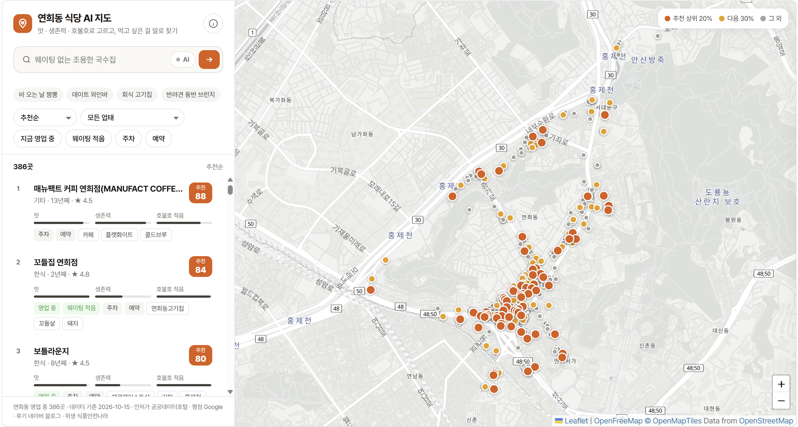

# 연희동 식당 AI 지도 (에너지 시스템 AI 수업 프로젝트)

> 오래 버텼고, 공개된 위생 처분이 없고, 평이 좋으면서 호불호가 덜 갈리는 연희동 식당을, 먹고 싶은 걸 말로 검색해서 찾는 지도

상명대학교 전기공학전공 202410929 유지연

- **지도:** https://oojiyn5.github.io/yeonhui-food-map/
- **발표 자료:** https://oojiyn5.github.io/yeonhui-food-map/presentation/ (←/→ 넘기기, N 발표자 노트) · [PDF](web/presentation/yeonhui-food-map-presentation.pdf)



저장소에는 코드와 지도(`web/`)만 있다. API 키(`.streamlit/secrets.toml`)와 수집 데이터(`data/`, 원본 CSV)는 올리지 않았으므로,
다시 돌리려면 아래 "실행 전 준비"대로 데이터를 받고 키를 넣어야 한다.

예전에 만든 연희동 중식당 맛집지도를 확장한 프로젝트.
연희동 **모든 식당**을 **맛 · 생존력** 두 축으로 평가하고, 공개된 **위생 처분은 경고로 표시**해서, 나에게 맞는 식당을 추천한다.

## 결정사항
- **범위:** 모델 학습은 서울 전체 식당, 지도 표시는 연희동만.
- **화면:** Streamlit 대신 정적 HTML(Leaflet, GitHub Pages 배포. 2026-10-14 확정: 무료, 키 불필요).
  계산은 Python에서 미리 해서 `restaurants.json`으로 내보내고, HTML은 결과만 보여준다.
- **Google 리뷰 5개 제한:** 우회하지 않는다(크롤링은 약관 위반). 네이버 블로그 검색 API 요약문으로 대체한다.
- **위생은 점수 축이 아니라 경고 표시 (2026-10-14 변경):** 공표기간(최근 2년) 처분은 서울 전체 281건, 영업 중 가게의 영업정지는 27건뿐이라
  거의 모든 가게가 같은 값이 된다. 처분이 있으면 경고로 보여주고, 없으면 "최근 2년 공개된 행정처분 없음 (기준일 YYYY-MM-DD)"으로 표시한다.
- **위생 정보:** 민원 "신고"가 아니라 공표된 **행정처분**만 쓴다.
  공개기한 안의 기록만, 사실·날짜·출처만 표시한다. 개별 가게의 위반 가능성 예측은 표시하지 않는다.

## AI 구성
| # | 기능 | 기법 | 우선순위 |
|---|---|---|---|
| ① | 폐업 예측 (생존력) | LightGBM 분류 / Cox 생존분석 + SHAP 해석 | 핵심 |
| ② | 위생 심각도 | 행정처분 위반내용 텍스트 분류 (전국 2,722건으로 학습, 경고 문구의 심각도 표시용) | 보조 |
| ③ | 호불호 지수 (기존 표준편차 대체) | 블로그 광고 필터 → 감성분석 → 감성 점수 분산 | 핵심 |
| ④ | 키워드·자연어 검색 | KeyBERT 키워드 추출, 임베딩 검색 | 핵심 |
| ⑤ | 평점 신뢰도 | 리뷰 수를 반영한 베이지안 신뢰구간 | 보조 |

## 데이터 수집 (`collect/`)
| 단계 | 스크립트 | 데이터 출처 | 결과 파일 |
|---|---|---|---|
| 1 | `step1_licenses.py` | 공공데이터포털 `식품_일반음식점_서울특별시` CSV (직접 다운로드) | `data/seoul_restaurants.csv`, `data/yeonhui_restaurants.csv` |
| 2 | `step2_dispositions.py` | 식약처 행정처분결과 API (I2630) | `data/yeonhui_dispositions.csv` |
| 3 | `step3_google_places.py` | Google Places API (New) | `data/yeonhui_google.csv` |
| 4 | `step4_naver_blog.py` | 네이버 블로그 검색 API | `data/yeonhui_blogs.csv` |

### 실행 전 준비
1. 공공데이터포털에서 `식품_일반음식점_서울특별시` CSV를 받아 `data/raw/`에 넣는다. (옛 전국일반음식점표준데이터 링크는 LOCALDATA 폐쇄로 403. 2026-10-14 확인)
2. [식품안전나라](https://www.foodsafetykorea.go.kr/api/) 인증키와 네이버 클라우드 NAVER API HUB 검색 API 키(개발자센터 키는 사용 불가)를 발급받는다.
3. `.streamlit/secrets.toml`에 키를 추가한다. Google Cloud에서 Places API (New)도 켜둔다.
   ```toml
   gmaps_api_key = "..."        # 이미 있음
   foodsafety_api_key = "..."
   naver_client_id = "..."
   naver_client_secret = "..."
   ```

### 실행
```bash
pip install requests pandas toml pyproj
pip install matplotlib lifelines lightgbm scikit-learn shap   # analysis/ 용
cd collect
python step1_licenses.py
python step2_dispositions.py
python step3_google_places.py --limit 20   # 소량 테스트 후 --limit 빼고 전체 실행
python step4_naver_blog.py --limit 20
python step5_google_details.py
python step6_naver_extra.py
cd ../analysis   # pip install sentence-transformers kiwipiepy (torch는 CPU용)
py survival_model.py; py blog_nlp.py; py shop_info.py
```
⚠️ `--limit`으로 다시 돌리면 결과 CSV가 그 개수만큼으로 덮어써진다(캐시는 그대로). 테스트 후엔 꼭 `--limit` 없이 한 번 더 실행.
중간에 끊겨도 다시 실행하면 `data/cache/`에 받아둔 부분은 건너뛴다.

### 실행 후 확인할 것
- step2는 API 응답 필드명을 출력한다. 업소명·주소 필드를 못 찾으면 스크립트 상단의 `NAME_KEYS`/`ADDR_KEYS`를 고친다.
- step2는 상호로 매칭하므로 같은 이름의 다른 가게가 섞일 수 있다. 주소를 눈으로 확인한다.
- step4는 "관련 글 10건 미만 식당 수"를 출력한다. 이런 식당은 호불호 지수의 근거가 부족하다.

## 진행 상황
- [x] 주제·구조 결정 (2026-10-09)
- [x] 수집 스크립트 1~4단계 작성 (step1은 가짜 데이터로 검증)
- [x] 일반음식점 CSV 확보, step1 실행 (2026-10-14): 서울 539,850건, 연희동 1,661건(영업 391), 좌표 없음 6.1%
- [x] API 키 발급: 식품안전나라, 네이버 API HUB (2026-10-14)
- [x] step2~4 실행 (2026-10-14)
  - step2: 공표기간(최근 2년) 서울 처분 372건, 서대문구 6건, **연희동 0건**(매칭 실패 아님, 실제로 없음)
  - step3: 연희동 영업 391곳 중 299곳 구글 매칭(상호 유사도 ≥0.7, 거리 ≤150m). "홍연 국수→홍연약국" 오매칭 1건 남음, primary_type으로 걸러낼 것
  - step4: 네이버 블로그 수집 완료
- [x] ① EDA (`analysis/eda_survival.py`, 결과 `analysis/output/`) (2026-10-14)
  - 축제·행사 임시 부스(상호 "한시적" 또는 10㎡ 미만·60일 내 폐업) 4,500곳 제외 → 535,323곳
  - 서울 중앙 생존기간 6.2년(3년 생존 70%). 연희동도 6.0년으로 서울과 차이 없음(p=0.08)
  - 생존에 차이가 큰 변수: 업태(중식 10.0년, 분식 4.7년), 면적(33㎡ 미만 5.0년, 66㎡ 이상 7.8년), 개업 시기(2020년 이후 4.2년)
  - 주의: 폐업 기록은 1990년대 초부터 있음 → 1990년 이전 개업 가게는 일찍 폐업한 곳이 빠져 생존기간이 부풀려짐(좌측 절단). 모델에선 1990년 이후 개업만 쓰거나 진입 시점을 보정할 것
- [x] ① 생존분석 모델 (`analysis/survival_model.py`, 결과 `data/yeonhui_survival.csv`) (2026-10-15)
  - 방식: 1990년 이후 개업 가게를 '개업 후 k년차' 구간 346만 개로 펼쳐 1년 내 폐업을 예측(LightGBM 이산시간 생존모델).
    주변 식당 수·작년 주변 폐업 수는 그 당시 기준(약 300m 격자)으로 계산. 2021년까지 학습 → 2022~2024 검증
  - 검증 AUC: 단순 규칙 0.592 / Cox 0.611 / **LightGBM 0.632**. 실제 폐업률 11.1%인데 평균 예측 9.4%(조금 낮게 예측)
    → 인허가 정보만으로는 어느 정도만 예측됨. 지도엔 확률보다 "서울 영업 중 가게 중 위험 순위"로 보여줄 것
  - Cox 위험비(한식 대비): 분식 1.37, 경양식 1.33, 중식 0.83. 면적 클수록, 주변 식당 많을수록 오래 버팀
  - 서울 영업 중 3년 위험 중앙값 26%(연희동 30%). 영업 연수별 0-2년 35% → 21년+ 19%로 오래된 가게일수록 낮음
  - 연희동 384곳 대상(1990년 이전 개업 7곳은 모델 밖 → 지도에선 "30년 이상 영업"으로 표시할 것)
  - SHAP 요인에서 연도·자치구는 연희동 가게 모두 같은 값이라 표시에서 뺌. "지점(○○점)"이 위험↑로 나오면 "개인 상호(지점 아님)" 뜻이니 지도 문구에서 바꿔 쓸 것
  - 2026-10-15 수정: 단순 규칙 비교에서 행마다 294만 행 평균을 다시 계산하던 버그(1시간 걸림)를 고침
- [x] 블로그 재수집·추가 수집 (2026-10-15)
  - step4: 지점명 빼고 검색("지호한방삼계탕 연희점"→"지호한방삼계탕"), 괄호 안 영문명도 상호로 인정. 391곳 완료(관련 글 중앙값 49건)
  - 짧은 상호('가을', '우주' 등 43곳)는 `name_ambiguous` 표시, 분석에서 제목 언급만 인정
  - step5 (`step5_google_details.py`): 구글 Place Details 299곳. 값 있는 비율 주차 12%, 예약 39%, 영업시간 72%, 전화 68%
  - step6 (`step6_naver_extra.py`): "연희동 {상호} 예약/웨이팅/주차" 블로그 1,173건 검색, 상호 언급 21,501건
  - 구글 '인기 시간대'·캐치테이블·테이블링·네이버 지도 리뷰는 공개 API가 없음 → 크롤링하지 않고 블로그 언급으로 대체, 지도엔 네이버 지도 링크만
- [x] ③④ 블로그 분석 (`analysis/blog_nlp.py`, 결과 `data/yeonhui_blog_nlp.csv`, `yeonhui_shop_emb.npz`) (2026-10-15)
  - 관련 글 38,351건(356곳), 광고·홍보 의심 1.5% 제외(협찬 문구 91건 + 여러 블로거가 같은 문장 490건, 대부분 해시태그·정보 나열)
  - 감성: 구글 리뷰 1,448건(부정 71건)으로 e5 임베딩 + 로지스틱 회귀. 구글 리뷰 교차검증 AUC 0.96
  - ⚠️ 블로그엔 부정 글이 1.8%뿐이고, 블로그 감성 평균과 구글 평점의 상관이 약함(ρ=0.16, p=0.08). 호불호 지수는 "참고용"으로 표시할 것
  - 키워드: Kiwi 명사 → 가게별 TF-IDF → MMR 5개 (예: 호천식당 "메밀국수, 숯불, 자가제면, 들기름")
  - 임베딩은 `analysis/checkpoints/blog_emb.npz`에 저장(재실행 시 새 글만 계산, 처음 계산은 약 25분)
- [x] 예약·웨이팅·주차 정보 (`analysis/shop_info.py`, 결과 `data/yeonhui_info.csv`) (2026-10-15)
  - 정보가 있는 가게: 예약 방법 42%, 웨이팅 판단 74%, 주차 45%. 예약 방법은 언급 수·최근 언급일·근거 링크와 함께 저장
  - 웨이팅은 연희동 안 상대 비교(드묾/가끔/잦음), 붐비는 때는 웨이팅 글에 같이 나온 점심/저녁/주말/평일
  - 주의: (주)카덴(2층)과 (주)우동카덴(1층)은 같은 건물 두 인허가이고 블로그 글이 겹침 → 지도에서 하나로 합칠지 확인
- [x] ⑤ 베이지안 평점 + `restaurants.json` 내보내기 (`analysis/export_json.py` → `web/restaurants.json`, 678KB) (2026-10-15)
  - 평점 = (20·연희동 평균 4.22 + 리뷰수·평점)/(20 + 리뷰수), 80% 하한도 저장. 구글 평점 있는 가게 259곳
  - 한 가게의 인허가 여러 개(같은 건물+상호 포함, 또는 같은 상호 60m 이내) 5건 합침: 카덴, 한우명가, 이화정, 청송면옥, 앤트러사이트 → 386곳
  - 표시 이름에서 "(주)" 제거, SHAP "지점" 요인은 "개인 상호(지점 아님)"/"지점(체인)"으로 바꿔 표시
- [x] HTML 지도 (`web/index.html`, Leaflet + CARTO 타일) (2026-10-15)
  - 추천순 = 맛 50% + 생존력 30% + 호불호 적음 20% (정보 없으면 중간값). 맛·생존력·호불호순 정렬, 업태·웨이팅 적음·주차·예약 필터
  - 상세 팝업: 맛/생존력(버팀·위험 요인)/호불호(참고용)/위생/예약(근거 링크)/웨이팅·몰리는 때/주차/전화/영업시간/편의, 네이버·구글 지도 링크
  - 검색: 키워드 검색(바로) + "AI 의미 검색"(브라우저에서 Xenova/multilingual-e5-small, 약 120MB 첫 로드).
    의미 유사도만 쓰면 글이 두루뭉술한 가게가 모든 질문에 떠서, 키워드 일치 +0.012/단어, 조건(주차·반려견·회식·웨이팅·예약) 일치 +0.008을 더함
  - Node로 가짜 DOM에서 실행해 386곳 마커·팝업·정렬·필터·키워드 검색 오류 없음 확인. **실제 브라우저에서 AI 검색(모델 로드)은 아직 확인 안 함**
  - 로컬 확인: `py -m http.server 8765 --directory web` → http://127.0.0.1:8765 (file://로 열면 JSON을 못 읽음)
- [x] 지도 화면 개선 (2026-10-15)
  - CARTO 타일이 API 키를 요구해 "API KEY REQUIRED"가 떠서 OpenStreetMap 기본 타일로 교체(CSS로 채도 낮춤, 다크 모드는 반전)
  - 새 디자인: Pretendard 폰트, 추천 점수 배지·맛/생존력/호불호 미니 막대·웨이팅/주차/예약 배지 카드, 등급별 마커(상위 20%/다음 30%/그 외)+범례,
    오른쪽 상세 패널(모바일은 아래 시트): 점수 타일 3개, 방문 정보, 오늘 요일 강조 영업시간, SHAP 요인, 네이버·구글 지도 버튼, 예시 검색어
  - 블로그: 연희동 주변 지명(연희·신촌·연대·홍대 등)이 없는 글 1,076건 제외(체인 다른 지점·동명 가게). 키워드에서 지명·상호 포함 단어 제외
  - 남은 한계: "제이에이치(JH)"처럼 흔한 이름은 여전히 다른 업체 글이 섞여 키워드가 엉뚱함
- [x] 배경 지도: OSM 기본 타일이 너무 빽빽해 OpenFreeMap Positron(벡터, 키 불필요, 지명 한국어)으로 교체. WebGL 없으면 OSM 타일로 대체. 처음 화면은 가게들에 맞춤 (2026-10-15)
- [x] 마무리 다듬기 (2026-10-15)
  - "분석 방법" 설명 창(ⓘ): 점수 계산식, 검증 수치(생존 AUC 0.632, 감성 AUC 0.96, 블로그-구글 상관 0.15), 쓰지 않은 데이터, 한계
  - "지금 영업 중" 필터: 구글 영업시간을 요일별 분 구간으로 변환(`export_json.parse_hours`, 1,505개 항목 전부 해석, 자정 넘김 처리). 212곳에 영업시간 있음
  - 폐업 소식: 구글 '영업 종료' 표시(연희돈멘) 또는 제목에 상호가 독립된 단어로 나오고 폐업 표현이 있는 글(목란, 2022-04 폐업 기사) → 빨간 배지·근거 링크, 목록 맨 아래.
    인허가 데이터엔 둘 다 아직 '영업 중'으로 남아 있음
  - 블로그 주제 필터: 전체 글 평균과 유사도 하위 2%(746건, 전시회·건물 경매 기사 등)는 감성·키워드·검색에서 제외
  - 상호 처리에서 "주식회사/(주)/㈜" 제거(법인 상호 8곳 매칭 개선). 짧은 상호(44곳)는 키워드 숨김
  - 남은 한계: "제이에이치(JH)"는 다른 회사 글이 섞여 키워드가 엉뚱함
- [ ] 실제 브라우저에서 AI 검색·모바일 화면 확인 → GitHub Pages 배포 (`web/` 폴더만 올리면 됨. `.streamlit/secrets.toml`·원본 CSV는 올리지 말 것)
- [ ] (선택) ② 행정처분 분류(연희동은 처분 0건이라 우선순위 낮음), 네이버 지역 검색 API로 세부 업종 보충
